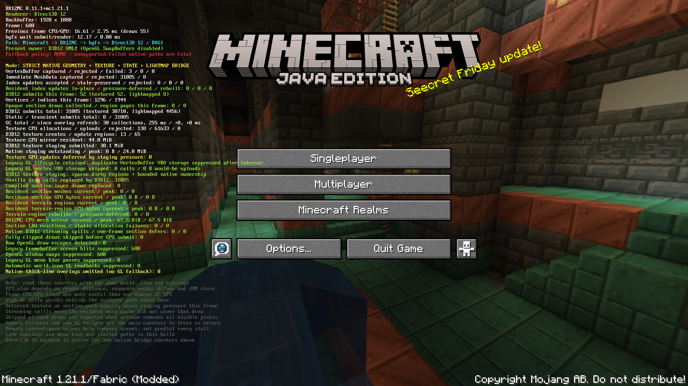

<h1>
  
  DX12MC
</h1>

DX12MC (also called DXMC) is a client-side Fabric mod that renders Minecraft Java Edition with Direct3D 12 through bgfx instead of OpenGL.

The project is experimental and Windows-focused. It is a hobby project made to learn how graphics rendering works, and it does not claim to be better than any other renderer or mod.

Download: [Modrinth](https://modrinth.com/mod/dx12mc) · [CurseForge](https://www.curseforge.com/minecraft/mc-mods/dx12mc)

  

The overlay is a developer tool, enabled with `-Ddx12mc.overlay=true`.

## Status

Geometry, textures, render state and shaders that Minecraft normally sends to OpenGL go to Direct3D 12 instead. Terrain, entities, text, fog, block outlines, the end portal and screenshots are drawn this way, and Video Settings and F3 report the Direct3D 12 backend.

Offscreen render targets and post-processing run on Direct3D 12, which covers menu background blur, glowing outlines and the creeper, spider and enderman spectator effects.

It is not a complete OpenGL replacement. The Fabulous graphics mode is not offered, and panorama and other offscreen screenshots do not work. If something needs a path that does not exist yet, the mod stops with an error instead of falling back to OpenGL.

See `ARCHITECTURE.md` for a source-level overview, and `docs/API.md` for the experimental API and shader pack format for other mods.

## License

Source code is licensed under LGPL-3.0-only. See `LICENSE` and `NOTICE`.

Third-party components keep their own licenses. See `THIRD_PARTY.md`.

## Brand

The DX12MC name and project logo are not licensed under LGPL-3.0.

Forks and redistributed builds must use their own name and branding, and must not present themselves as the official DX12MC project or release channel.

## Contributions

Pull requests are welcome. Maintainer approval is required before changes are merged or released under the DX12MC name. See `CONTRIBUTING.md`.
